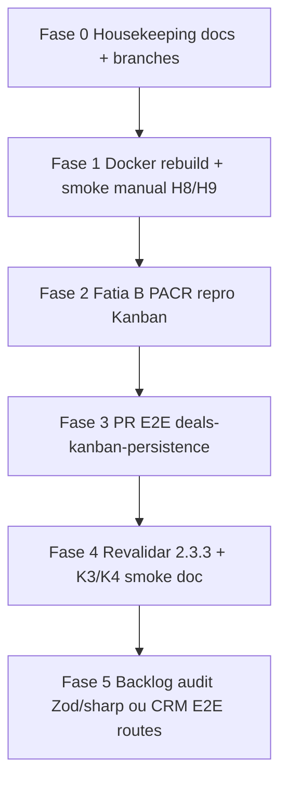

# Plano de execução — restante, implantação e refinamento

**Data:** 26/11/2026  
**Base:** `develop` @ **`e057f790`**  
**Contrato:** 1 fatia → 1 PR → gate CI → merge humano (sem auto-merge).

---

## 1. Estado atual (já mergeado)

| Área | Evidência |
|------|-----------|
| Overview Rentals/Sales API | #590–#591, #599 — props `overview.tsx` |
| E2E overview H8/H9 | #600 — `npm run test:e2e:overview-portfolio` |
| Segurança deps | #598 lockfile, #601 nodemailer 10, #602 Next 16.4.6 |
| CRM hub / leads / contacts | #563–#587, #582–#583 (histórico smoke H1–H7b) |
| E-sign locações P1 | #550, K1–E8 smoke doc |
| Kanban DnD + API persistence (backend) | #547, `crm_deals`, scripts `smoke:crm-deals-persistence*` |

**Documentação âncora:** `HANDOFF-CONTINUACAO-2026-11-26.md`, `SMOKE-CRM-*`, briefs NPM/nodemailer/Next.

---

## 2. O que falta **concluir** (entregáveis com critério de done)

### Fatia B — Kanban persistência (UI + E2E)

| Item | Gap | Done quando |
|------|-----|-------------|
| **2.3.3** modal pipeline | Clique “Negociação” OK; **persistência não revalidada** pós F5 | Playwright ou smoke script + passo em `SMOKE-CRM-DEALS` |
| **K3/K4** UI | Scripts API existem; falta **E2E browser** DnD + refresh | Spec `deals-kanban-persistence.spec.ts` (H7b/K3/K4) verde 3× |
| **H7** lead→deal | Manual documentado; sem E2E automatizado | Opcional: estender suite routes |

**Bloqueio enterprise:** sem repro Playwright documentado → não refatorar persistência no client.

### E2E / smoke em falta

| Suite | Cobertura hoje | Falta |
|-------|----------------|-------|
| Overview portfólio | H8/H9/H8c/H9b | — |
| CRM routes | H1–H9 manual | Playwright deals/leads/contacts (exceto overview) |
| E-sign | Script + manual E1–E8 | E2E UI contratos (nice-to-have) |

### Housekeeping documental

| Ficheiro | Ação |
|----------|------|
| `HANDOFF-CRM-DEALS-2026-11-25.md` | Atualizado 26/11 — SHA `e057f790` |
| `CONTINUAR-CRM-DEALS-2026-11-13.md` | Banner topo `@ e057f790` + link plano |
| Branches mergeadas | Apagar locais (lista handoff) |

---

## 3. O que falta **implantar** (ops / ambiente)

| Item | Por quê | Passos |
|------|---------|--------|
| **Docker turismo** | Imagem anterior a #600–#602 | `docker compose build turismo && docker compose up -d turismo` |
| **DEALS_PERSISTENCE=postgres** | K3/K4 em produção/staging | Confirmar `docker-compose.yml` + migrate 0066+ |
| **Smoke pós-deploy** | Regressão rápida | `test:e2e:overview-portfolio` + `smoke:crm-deals-persistence` com `SMOKE_BEARER` |
| **Node 24 no dev/CI** | Evitar drift lock (v26 local) | `nvm use 24` / agente CI já 24 |
| **CI E2E overview** | Só roda local hoje | Issue/PR harness opcional (credenciais GitHub secrets) |

---

## 4. O que falta **refinar / melhorar** (não bloqueador)

| Tema | Risco | Fatia sugerida |
|------|-------|----------------|
| **npm audit** `zod` v4 | Breaking schemas | PR dedicada migração Zod |
| **npm audit** `sharp` / `next` high transitivos | Allowlist até bump coerente | Junto de major Next ou pin sharp |
| **Turismo `type-check`** | Erros pré-existentes fora escopo | PR incremental por pasta |
| **Turismo `lint`** | `node_modules` / env parcial em doc antigo | `npm run lint -w apps/turismo` + fix mínimo |
| **`pages/reservei/package.json`** Next 15.5.21 | CVE / drift | PR isolada ou deprecar pacote aninhado |
| **Playwright clipboard 2.3.4** | #587 cobre UX | Nice-to-have E2E |
| **Dependabot** 248 alerts default branch | Maioria transitiva | Inventário trimestral, não misturar com produto |

---

## 5. Ordem de execução recomendada (segura)



| Fase | Duração orient. | Saída |
|------|-----------------|-------|
| **0** | 30 min | Handoffs + plano + branches locais limpas |
| **1** | 20–40 min | Evidência Docker = dev para overview |
| **2** | 1–2 h | Repro escrito + falhas conhecidas (se houver) |
| **3** | 1 PR | Spec Playwright + config; CI ou doc “local only” |
| **4** | Smoke | `SMOKE-CRM-DEALS` 2.3.3 ✅ persistência |
| **5** | Por prioridade owner | PRs chore separadas |

---

## 6. Progresso sessão 26/11 (retomada)

| Feito | Detalhe |
|-------|---------|
| ✅ Plano mestre | Este ficheiro |
| ✅ Handoffs | `HANDOFF-CRM-DEALS`, `CONTINUAR-CRM`, `HANDOFF-CONTINUACAO` |
| ✅ Branches locais | Removidas mergeadas (#601, #602, …) |
| ✅ E2E K1 | #603 mergeado |
| ⏳ E2E K3 | Modal Negociação + reload (PR em curso) |
| ⏳ K4 | `smoke:crm-deals-persistence:k4` (script; fora Playwright) |

**Comando K1:**

```powershell
$env:E2E_TURISMO_URL="http://localhost:3005"
$env:E2E_AUTH_EMAIL="admin@rsv360.com.br"
$env:E2E_AUTH_PASSWORD="<dev — TROUBLESHOOTING-LOGIN-LOCAL.md>"
npm run test:e2e:deals-kanban
```

---

## 7. Prompt de retomada

```text
Pull develop @ <HEAD>. Leia PLANO-EXECUCAO-RESTANTE-2026-11-26.md.
Fase N: <0–5>. Objetivo: <ex. Kanban B E2E>.
```